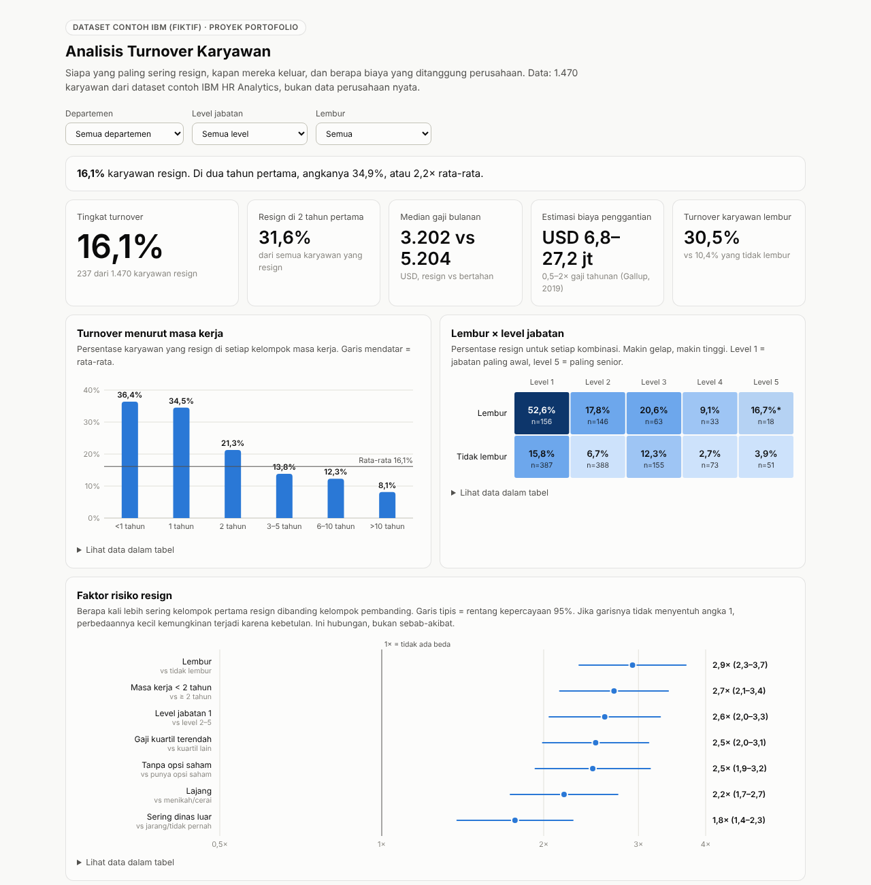

# Analisis Turnover Karyawan

> **Dataset contoh, bukan data perusahaan nyata.** Proyek ini memakai IBM HR Analytics Employee
> Attrition (1.470 karyawan), data fiktif buatan IBM untuk latihan analisis, dari
> [IBM/employee-attrition-aif360](https://github.com/IBM/employee-attrition-aif360) (lisensi Apache 2.0).

**Dashboard interaktif:** <https://ratuadisyaa.github.io/analisis-turnover-karyawan/>



## Ringkasan

**16,1%** karyawan resign, tetapi di dua tahun pertama angkanya **34,9%**, sekitar 2,2× rata-rata.
Risiko resign paling kuat berkaitan dengan **lembur** (2,9×), **masa kerja di bawah 2 tahun** (2,7×),
**level jabatan awal** (2,6×), dan **gaji di kuartil terendah** (2,5×). Dengan patokan biaya
penggantian 0,5–2× gaji tahunan, karyawan yang resign menimbulkan estimasi biaya
**USD 6,8–27,2 juta**.

## Masalah bisnis

Mengganti karyawan itu mahal. Gallup memperkirakan biayanya 0,5–2× gaji tahunan karyawan tersebut
([Gallup, 2019](https://www.gallup.com/workplace/247391/fixable-problem-costs-businesses-trillion.aspx)),
mencakup rekrutmen, pelatihan, dan produktivitas yang hilang. Tim HR perlu tahu kelompok mana yang
paling rawan resign agar program retensi tepat sasaran.

### Pertanyaan

1. Kapan karyawan paling banyak resign: di tahun-tahun awal atau setelah lama bekerja?
2. Departemen dan jabatan mana yang turnovernya paling tinggi?
3. Apakah lembur, gaji, dan level jabatan berkaitan dengan keputusan resign? Seberapa kuat?
4. Berapa estimasi biaya yang ditanggung perusahaan?

## Temuan

**1. Risiko terbesar ada di tahun-tahun awal.** Turnover karyawan dengan masa kerja di bawah 1 tahun
36,4% dan 1 tahun 34,5%, lalu terus turun sampai 8,1% untuk masa kerja di atas 10 tahun. 31,6% dari
semua karyawan yang resign keluar dalam 2 tahun pertama.

**2. Lembur adalah faktor terkuat.** Karyawan yang lembur resign 30,5%, dibanding 10,4% yang tidak
lembur (2,9×, rentang 95%: 2,3–3,7). Kombinasi paling rawan: **level jabatan 1 yang lembur, 52,6%
resign**.

**3. Gaji dan level awal saling memperkuat.** Turnover kuartil gaji terendah 29,3%, dibanding 10,3% di
kuartil tertinggi. Median gaji bulanan karyawan yang resign USD 3.202, dibanding USD 5.204 untuk yang
bertahan.

**4. Jabatan paling rawan:** Sales Representative (39,8%), Laboratory Technician (23,9%), dan Human
Resources (23,1%). Departemen Penjualan 20,6%, Riset & Pengembangan 13,8%.

**5. Faktor lain:** karyawan lajang (25,5%), yang sering dinas luar (24,9%), dan yang tidak memiliki
opsi saham (24,4%) juga lebih sering resign.

Semua risiko relatif di atas memiliki rentang kepercayaan 95% yang tidak menyentuh angka 1
([`outputs/hasil_analisis/risiko_relatif.csv`](outputs/hasil_analisis/risiko_relatif.csv)).

## Rekomendasi

| Masalah | Rekomendasi | Ukuran keberhasilan |
| --- | --- | --- |
| Turnover tinggi di 2 tahun pertama | Program onboarding dan mentor 12 bulan, dengan evaluasi di bulan ke-3, 6, dan 12 | Turnover masa kerja < 2 tahun turun di bawah 25% |
| Lembur berkaitan kuat dengan resign | Pantau jam lembur per tim; batasi lembur rutin untuk level jabatan 1 | Porsi karyawan level 1 yang lembur rutin turun |
| Gaji level awal rendah | Bandingkan gaji level 1 dengan pasar untuk jabatan berturnover tertinggi | Selisih turnover kuartil gaji terendah vs tertinggi menyempit |
| Jabatan rawan | Stay interview dan exit interview terstruktur untuk Sales Representative dan Laboratory Technician | Alasan resign utama terdokumentasi setiap kuartal |

## Alur kerja

| Langkah | Berkas | Alat |
| --- | --- | --- |
| 1. Periksa kualitas data dan siapkan kolom | [`scripts/01_siapkan_data.py`](scripts/01_siapkan_data.py) → [laporan](outputs/laporan_kualitas_data.md) | Python, pandas |
| 2. Analisis turnover dan risiko relatif | [`scripts/02_analisis.py`](scripts/02_analisis.py) → [`outputs/hasil_analisis/`](outputs/hasil_analisis/) | Python, pandas |
| 3. Siapkan data dashboard | [`scripts/03_siapkan_data_dashboard.py`](scripts/03_siapkan_data_dashboard.py), [`docs/index.html`](docs/index.html) | HTML, CSS, JavaScript (SVG) |
| 4. Buat workbook Excel | [`scripts/04_buat_workbook_excel.py`](scripts/04_buat_workbook_excel.py) → `Analisis Turnover Karyawan.xlsx` | Excel: COUNTIFS, SUMIFS, PERCENTILE, grafik |

**Cara membaca risiko relatif:** angka 2,9× berarti kelompok tersebut 2,9 kali lebih sering resign
dibanding kelompok pembandingnya. Rentang kepercayaan 95% dihitung dengan metode logaritma.

## Keterbatasan

- **Data fiktif.** Temuan menunjukkan kemampuan analisis, bukan kondisi perusahaan nyata.
- **Hubungan, bukan sebab-akibat.** Misalnya, lembur dan level jabatan saling berkaitan, sehingga
  pengaruh masing-masing belum dipisahkan. Langkah berikutnya: model regresi logistik.
- **Data potret satu waktu.** Tidak ada tanggal resign, sehingga tren bulanan tidak bisa dihitung.
- **Tidak ada data kehadiran (absensi).**
- **Estimasi biaya** memakai patokan umum Gallup, bukan biaya rekrutmen perusahaan tertentu.

## Cara menjalankan

```bash
pip install -r requirements.txt
python jalankan_semua.py
```

Lalu buka `docs/index.html` di browser, atau `Analisis Turnover Karyawan.xlsx` di Excel.

## Struktur folder

```
├── data/
│   ├── ibm_hr_attrition.csv              data asli dari IBM
│   └── processed/karyawan_bersih.csv     data siap analisis
├── scripts/                              langkah 01–04 (Python)
├── outputs/                              laporan kualitas data, hasil analisis, ringkasan angka
├── docs/                                 dashboard (GitHub Pages)
├── Analisis Turnover Karyawan.xlsx       workbook Excel
└── jalankan_semua.py
```

## Penulis

**Ratu Adisya Famela** · [LinkedIn](https://www.linkedin.com/in/ratuadisyafamela)
